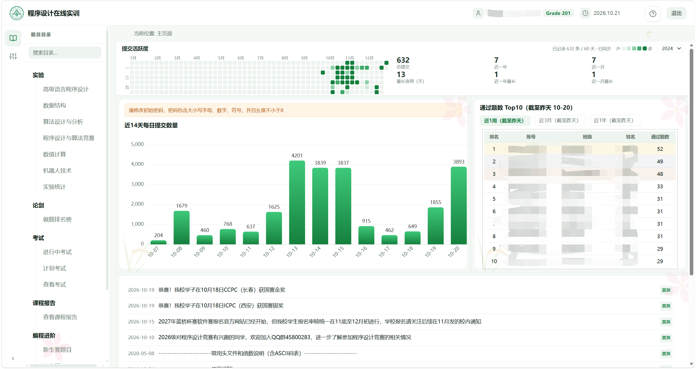
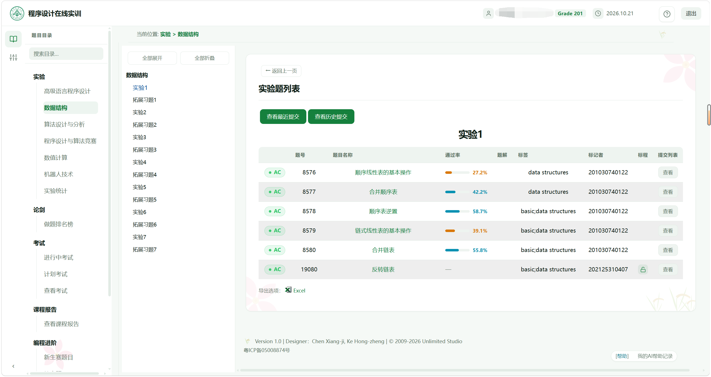
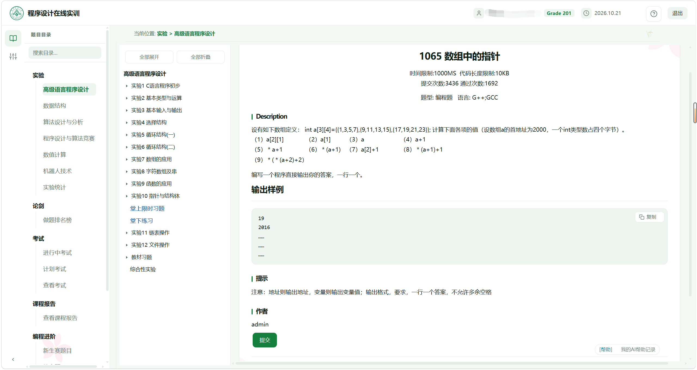
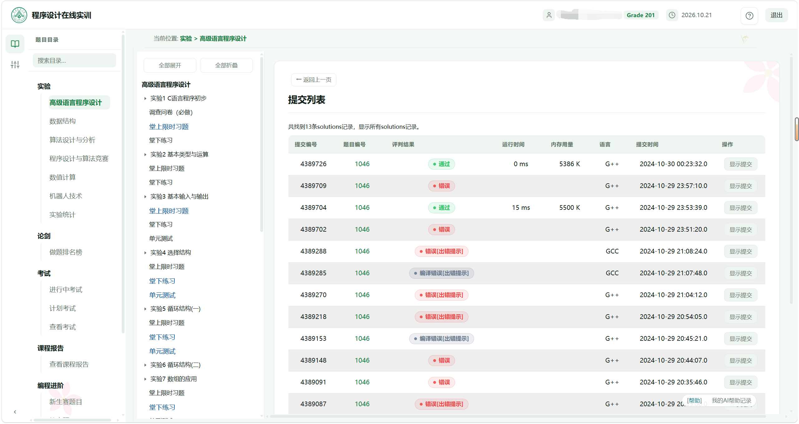
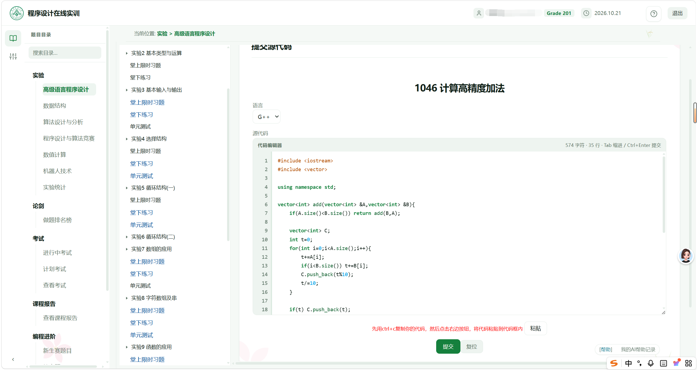

# 华农 OJ 美化 · SCAU OJ Refined

一个给**华南农业大学在线评测系统（OJ）** 换肤 + 补交互的 [Tampermonkey](https://www.tampermonkey.net/)（油猴）脚本。
只在浏览器本地运行，不改服务器、不替你提交代码，纯前端美化与体验修复。

> 适用站点：`https://acm.scau.edu.cn/uoj8000/`
> 浏览器：Chrome / Edge / Firefox（安装 Tampermonkey 扩展后即可使用）

---

## 效果预览

| 页面 | 说明 |
| --- | --- |
|  | **首页重做**：新增「提交活跃度」年度热力图、近 14 天提交柱状图、通过题数 Top10，数据来自你的真实提交记录 |
|  | **登录页**：清爽的浅绿登录卡片与背景 |
|  | **题目列表**：统一卡片风格、通过率进度条、AC 状态徽章、斑马纹表格 |
|  | **题目详情**：题面排版、中英文切换、代码编辑器与提交按钮美化 |
|  | **提交列表**：判题结果彩色徽章、等待倒计时修复，6 秒倒计时结束直接看到列表，返回不再死循环 |
|  | **提交代码**：编辑器配色、等宽字体、粘贴/排版修复 |

---

## 功能特性

### 🎨 全站外观重绘
- 一套统一的**现代浅绿 SaaS 风格**，配色、圆角、阴影、间距一致。
- 登录页、顶栏、左侧目录树、个人信息、题库、题面、提交页全面翻新。
- 判题结果用彩色徽章区分：**通过 / 错误 / 编译错误 / 超时 …**，一眼看清。
- 通过率做成进度条，表格斑马纹、悬浮高亮，长列表更好读。

### 🔥 提交活跃度热力图（首页新增）
- 仿 GitHub 贡献热力图，按天展示你**一整年的提交密度**，支持切换年份。
- 右侧自动统计：**总提交、近一年、近一月、最长连续天数**。
- 后台自动拉取你的全部提交记录并按学号分桶缓存，换账号不串数据；同步进度实时可见。
- 首次打开自动同步，之后只做增量更新。

### 📊 首页数据面板
- 近 14 天每日提交数量柱状图。
- 通过题数 Top10 榜单（近 1 周 / 近 3 月 / 近 1 年切换）。

### 🐛 顺手修掉的几个真 bug
- **点「查看」提交列表会被带回主页**：站点对列表页有"必须先经过 6 秒等待页"的保护，脚本接管后保证倒计时结束**正确进入列表**，而不是跳回主页。
- **等待时长 15 / 25 / 45 秒越等越久**：统一为站点原生的 6 秒倒计时，可预期、不递增。
- **「返回上一页」点不动、题目↔提交列表来回死循环**：等待页不再占用浏览器历史，连点返回会一路正常退出。
- 代码框拖动选择重影、编辑器错乱、部分页面英文/排版问题等细节修复。

---

## 安装

1. 先在浏览器安装 **Tampermonkey（油猴）** 扩展：
   - Chrome / Edge：扩展商店搜索 "Tampermonkey" 安装。
   - Firefox：附加组件商店搜索 "Tampermonkey"。
2. 打开本仓库的脚本文件 **`scau-oj-beautify.user.js`**，点 Raw（或直接打开）。
   - 例如地址形如：
     `https://raw.githubusercontent.com/<你的用户名>/<仓库名>/main/scau-oj-beautify.user.js`
3. Tampermonkey 会自动弹出安装页，点 **「安装」** 即可。
4. 打开 [华农 OJ](https://acm.scau.edu.cn/uoj8000/) 登录，即可看到新界面。

> 升级脚本：在 Tampermonkey 里重新打开脚本的 Raw 链接，会提示「重新安装 / 更新」。

---

## 使用

- 安装后**无需任何配置**，正常登录、刷题即可。
- 首页右下角的「提交活跃度」首次会自动同步，进度条上会显示当前同步状态；同步完成后热力图自动填充。
- 想切换年份：热力图右上角的下拉框即可。
- 脚本只在 `acm.scau.edu.cn/uoj8000` 下生效，不影响其他网站。

---

## 说明

- 这是个人学习/练手作品，**与华南农业大学及 OJ 官方无关**，不代表官方立场。
- 脚本只在你自己的浏览器里改样式与交互，**不修改服务器数据、不自动提交代码、不绕过判题与权限**。
- 站点为 AppFuse + Struts 的老 JSP 系统，若官方改版导致个别页面样式异常，属正常现象，更新脚本即可。
- 请遵守学校 OJ 使用规范，合理使用。

---

## License

[MIT](LICENSE) © 甘俊宏 (Gan Junhong)
